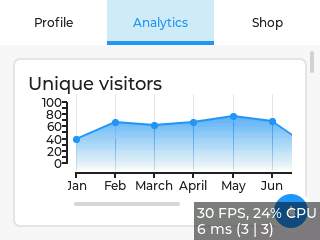
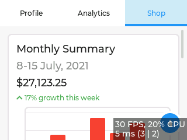
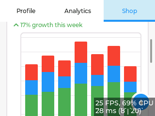
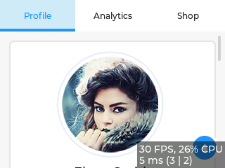
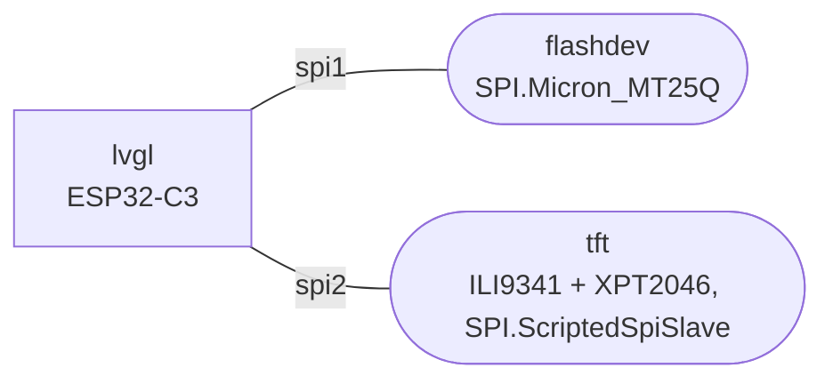

## This fork: LVGL's demos running on a simulated ESP32-C3

Simantic's fork of LVGL, kept as a simulation showcase. `sim/` builds LVGL's own demos (`lv_demo_widgets`,
`lv_demo_music`, `lv_demo_benchmark`) as an ESP-IDF 5.4.4 project and runs the real firmware image on a simulated
ESP32-C3 (released `sim` 0.10.1) with a simulated ILI9341 SPI panel and a simulated XPT2046 touch controller. Every
picture below is a frame of the panel peer's frame memory from a real run (240x320 RGB565, shown 320x240 landscape),
not a mock-up. The LVGL sources are unchanged; nothing is offered back or posted upstream. The only code added is under
`sim/` (a 130-line ESP-IDF host app, `sim/fw/main/main.c`, and the peers and scripts around it).

| Profile | Analytics (tap) | Shop (tap) | Shop, scrolled (drag) | Profile (tap) |
| --- | --- | --- | --- | --- |
|  |  |  |  |  |

Animated: [widgets](sim/screenshots/widgets.gif) (14 s of virtual time, 52 frames, touch-driven),
[music player](sim/screenshots/music.gif) (20 s), [benchmark](sim/screenshots/benchmark.gif) (first 40 s).
The "FPS / CPU / render + flush" overlay is LVGL's own performance monitor, measured by the firmware on the simulated
clock.

```sh
DEMO=widgets sim/build.sh   # DEMO=widgets|music|benchmark; needs ESP-IDF 5.4.x (~/.espressif/v5.4.4); about 1 min
DEMO=widgets sim/run.sh     # SECS=14: boots sim/flash-esp32c3-widgets.bin, writes PNGs to sim/out/, assembles the GIF
```

The merged flash images (`sim/flash-esp32c3-<demo>.bin`) are build output and are not committed. `sim/run.sh` needs
`sim` on PATH, python3 and Pillow (for the GIF).

**What runs** (`sim` 0.10.1 build ccc73c89, ESP-IDF v5.4.4, 2026-11-16):

| Part | In the simulation |
| --- | --- |
| Firmware | ESP-IDF project `sim/fw`, LVGL as a component (`sim/fw/components/lvgl` is a symlink to this tree), `CONFIG_LV_USE_STDLIB_MALLOC_CLIB`, 16 bpp, partial render mode with a 320x30 RGB565 buffer, SPI at 40 MHz with DMA, software chip selects. Booted through the built-in C3 mask ROM and the IDF bootloader |
| ESP32-C3 | released `sim ESP32-C3` model, board file `sim/c3.board` |
| Panel | `sim/peers/ili9341.py`: a vendored copy of sim-fixtures' `peers/spi/ili9341.py` (ILI9341 datasheet V1.11; CASET/PASET/RAMWR, MADCTL MV, COLMOD, sleep/reset timing diagnostics, 240x320 frame memory). Fork addition: snapshots the frame memory to numbered raw files when it changed and 100 ms of virtual time passed (`ILI9341_SEQ_DIR`) |
| Touch | same peer, a second chip select (GPIO3): an XPT2046-style controller answering 0xB1 (pressure), 0xD1 (X), 0x91 (Y) with 12-bit values. MODELED SIMPLIFICATION: the finger is a table of segments at fixed virtual times (`TOUCH_SCRIPT`), raw value = pixel scaled to 0..4095 with no calibration offset or noise; the pen-IRQ pin is not modelled (the firmware polls pressure every LVGL indev read) |
| SPI2 bus | one peer for both chip selects, as the crosspoint fork does for its SD card and panel. MODELED SIMPLIFICATION, see gaps 1 and 4 |
| Display colours | the firmware sets MADCTL `0x28` (MV, BGR) as a real ILI9341 board does; the peer stores the words as sent, so the PNGs are the RGB565 words the firmware wrote (colours look right) |

System graph (`sim graph --scenario sim/scenario.yaml`):



**Configurations tried** (measured on this machine, load average 7 to 10 during the runs, so wall times are upper bounds):

| Configuration | Result |
| --- | --- |
| ESP32-C3, widgets demo, touch script, 14 s virtual | PASS (`sim/run.sh`): LVGL up at 0.80 s virtual; 277 RAMWR (panel window writes); 53 snapshots, all distinct; Profile to Analytics (tap at 2.0 s), Shop (4.5 s), Shop scrolled (drag 7.0 to 7.6 s), Profile (10.5 s) seen in the frames; 15.6 s wall. LVGL overlay: 30 FPS, 20 to 36 % CPU in the settled screens, 25 FPS / 69 % CPU while the Shop chart scrolls |
| ESP32-C3, music demo (auto-play), 20 s virtual | PASS: splash, then the player with the cover and spectrum ring; 578 RAMWR; 83 snapshots, 67 distinct; 49.4 s wall. The demo is laid out for larger panels: at 320x240 the track title and the controls are partly clipped by the panel edge (LVGL's layout, not a capture fault) |
| ESP32-C3, benchmark demo, 40 s virtual | PARTIAL: scenes "Empty screen", "Multiple rectangles", "Rotated ARGB images", "Containers with opa" reached, 4871 RAMWR, 46.6 s wall. The final results table was not reached within 40 s; how long the full run takes is `unverified` |
| ESP32-S3, same source, same board file | not working: see gap 1. The panel peer receives SPI bytes but no GPIO edges (DC, RESET), so the init commands are mis-decoded (`DIAG unknown_command: command 0x3F`, `RAMWR while the panel is in sleep`) and no frame is produced |
| ESP32 (classic), same source | not working: `--frames --frames-only spi` shows no SPI transaction at all after the firmware's "LVGL demo started" (pins HSPI 14/13, CS 15); not root-caused, `unverified` whether it is the model or the pin set |
| First attempt on C3: esp_lcd panel IO with the SPI block's own chip select | not working: the peer saw one select edge at the first byte and never a deselect, so it never wrote a frame; software chip selects (GPIO pads) work |

**Gaps, with the evidence** (engine or model side; not changed here, no issues filed):
1. **ESP32-S3: `SPI.ScriptedSpiSlave` never receives `on_gpio` for its wired pads.** With `gpio: 4 -> tft@1`
   (D/CX) and `5 -> tft@2` (RESET) the same firmware drives the pads (`--trace-out` logs the pad edges) and a
   `Scripted.ScriptedGpioPeer` wired to the same pads gets every edge (`GP 1 True 720000`, ...), but the panel peer's
   `on_gpio` printed nothing in a 1.1 s run, so it decodes pixel data as commands. The identical firmware and board file on
   ESP32-C3 delivers the edges. Tried pads 8/9/10 and 4/5/10, hardware and software CS: same. Hence this fork runs on the C3.
2. **ESP32-C3 has no `UART.ScriptedUartPeer`** (`build error: ts: no usable registration` for `uart0` and `uart1`; it
   is accepted on ESP32 and ESP32-S3), so touch could not be a UART stand-in and is an XPT2046 on the SPI peer instead.
3. **Peer pad events are time-quantised.** Four consecutive DC edges in `on_gpio` carry the same `ctx.now_us`
   (`GP 1 True 720000`, `GP 1 False 720000`, ...): the order is kept, the time is the chunk's. Not a problem for
   decoding here, but timing derived from pad edges inside one chunk is not available.
4. **The hardware chip select of the C3's SPI block is not mirrored to peers** (one `on_select` at the first byte, no
   `on_deselect`), which is why the firmware drives CS from GPIO. `unverified` whether that is intended.
5. The 0.10.1 C3 model ran the 14 s widgets run in about 1.1x real time on a loaded host and the 20 s music run in
   about 2.5x; no guest-side profile was taken (`unverified` what bounds the music run).

Build notes: ESP-IDF 5.4.4 from the existing install (nothing is downloaded; no component-registry packages are used
because the LVGL port code is the ~130 lines in `sim/fw/main/main.c`). Each build dir is about 270 MB, ignored by git.
`sim/build.sh` uses `bash` and sources `export.sh`; run it under `lockf` on a shared machine.

**Licence.** LVGL is MIT: `LICENCE.txt` reads "MIT licence, Copyright (c) 2025 LVGL Kft" and grants use, copy, modify,
merge, publish, distribute, sublicense and sell, provided the copyright and permission notice stay in all copies.
Third-party code and assets keep their own licences (`COPYRIGHTS.md`). Added files under `sim/` are offered under the
same MIT licence; `sim/peers/ili9341.py` derives from Simantic's sim-fixtures peer. ESP-IDF (Apache-2.0) is linked into
the flash images the build produces.

---

<p align="center">
  <a href="https://lvgl.io/docs" title="Documentation">Docs</a> •
  <a href="https://forum.lvgl.io" title="Community forum">Forum</a> •
  <a href="https://blog.lvgl.io" title="News and articles">Blog</a> •
  <a href="https://lvgl.io/services" title="Professional services">Services</a>
  
  <b>EN</b> •
  <a href="./docs/README_zh.md">中文</a> •
  <a href="./docs/README_ja.md">日本語</a> •
  <a href="./docs/README_ko.md">한국어</a> •
  <a href="./docs/README_pt_BR.md">PT</a> •
  <a href="./docs/README_he.md">עברית</a>
</p>

<p align="center">
  <a href="https://lvgl.io"></a>
  <h1 align="center">Light and Versatile Graphics Library</h1>
</p>

<br/>
<br/>

<div align="center">
  
  &nbsp;
  
</div>

<br/>
<br/>
<br/>

<p align="center">
  <a href="#overview" title="What LVGL is">Overview</a> •
  <a href="#features" title="What LVGL can do">Features</a> •
  <a href="#lvgl-pro" title="The professional toolchain">LVGL Pro</a> •
  <a href="#examples" title="C and XML examples">Examples</a> •
  <a href="#integration" title="How to add LVGL to your project">Integration</a> •
  <a href="#contributing" title="How to get involved">Contributing</a> •
  <a href="#license" title="Licensing terms">License</a>
</p>

## Overview

**LVGL** is a free and open-source UI library that enables you to create graphical user interfaces
for any MCUs and MPUs from any vendor on any platform.

**Requirements**: LVGL has no external dependencies, which makes it easy to compile for any modern target,
from small MCUs to multi-core Linux-based MPUs with 3D support. For a *typical* UI, you need only ~100kB RAM,
~200–300kB flash, and a buffer size of 1/10 of the screen for rendering.

**Wide adoption**: Chip vendors (like NXP, Espressif, Renesas, and so on), RTOS projects (Zephyr, NuttX, etc.),
and board manufacturers (Riverdi, Seeed Studio, VIEWE, Elecrow, etc.) have all integrated LVGL already. If a development board has a display, it's very likely
the vendor offers LVGL support too.

**Professional tools**: Instead of writing C code, you can hugely speed up and simplify UI development by using [LVGL Pro](#lvgl-pro), a complete toolkit with Editor, Figma integration, Online Viewer, and CLI. It exports pure LVGL C code from XML, with no extra runtime or hidden magic. It's free for non-commercial use and evaluation.

**To get started**, browse the [Examples](#examples), spin up a [Simulator project](https://lvgl.io/docs/open/integration/pc), explore the [Online Viewer](https://viewer.lvgl.io/) of LVGL Pro, compile and run a UI in a window in [LVGL Pro](https://lvgl.io/docs/pro/integration/simulator) with one click, or dive into our AI-ready [Docs](https://lvgl.io/docs/open). Just click [**Ask AI**](https://lvgl.io/docs/open)
and ask anything!

## Features

**Free, Portable, and Scalable**
  - A fully portable C (C++ compatible) library with no external dependencies.
  - Can be compiled for any MCU or MPU, with any (RT)OS. Make, CMake, and simple globbing are all supported.
  - Supports monochrome, ePaper, OLED, or TFT displays, or even monitors. [Displays](https://lvgl.io/docs/open/main-modules/display)
  - Distributed under the MIT license, so you can easily use it in commercial projects too.
  - At a bare minimum needs only 32kB RAM and 128kB Flash, a frame buffer, and at least a 1/10 screen-sized buffer for rendering.
  - OS, external memory, and GPU are supported but not required.

**Widgets, Styles, Layouts, and More**
  - 30+ built-in [Widgets](https://lvgl.io/docs/open/widgets): Button, Label, Slider, Chart, Keyboard, Meter, Arc, Table, and many more.
  - Flexible [Style system](https://lvgl.io/docs/open/common-widget-features/styles) with 100+ style properties to customize any part of the widgets in any state.
  - [Flexbox](https://lvgl.io/docs/open/common-widget-features/layouts/flex) and [Grid](https://lvgl.io/docs/open/common-widget-features/layouts/grid)-like layout engines to automatically size and position the widgets responsively.
  - [Data bindings](https://lvgl.io/docs/open/main-modules/data_binding/index.html) to easily connect the UI with the application.
  - Supports Mouse, Touchpad, Keypad, Keyboard, External buttons, Encoder [Input devices](https://lvgl.io/docs/open/main-modules/indev).
  - [Multiple display](https://lvgl.io/docs/open/main-modules/display/overview#how-many-displays-can-lvgl-use) support.

**Rendering**
  - Built-in 2D rendering engine supporting basic shapes, gradients, anti-aliasing, opacity, smooth scrolling, box and drop shadows, image transformation, etc.
  - [Powerful 3D rendering engine](https://lvgl.io/docs/open/libs/gltf) to show [glTF models](https://sketchfab.com/) with OpenGL.
  - Vector graphics, SVG, and Lottie support.
  - Text is rendered with UTF-8 encoding, supporting CJK, Thai, Hindi, Arabic, and Persian writing systems.
  - Built-in support for GPUs like VG-Lite, Dave2D, NeoChrome, OpenGL, etc.

## LVGL Pro

Building UIs in C works well, but it gets slow to iterate on and harder to keep consistent as a project grows.
[LVGL Pro](https://lvgl.io/pro) lets you build reusable components and screens visually, preview changes
instantly, and manage data bindings, translations, animations, and tests in one place.

Pro exports plain LVGL C code: the same LVGL you already use, with no extra runtime or dependency. It drops
into an existing project without changing how you build or ship.

<p align="center">
  
</p>

You can try it in the browser at [viewer.lvgl.io](https://viewer.lvgl.io) without installing anything, or
[download the Editor](https://lvgl.io/pro#download) and use it under the free Community license.

LVGL Pro consists of four tightly related tools:

1. **Editor**: The heart of LVGL Pro. A desktop app to build components and screens in XML, manage data bindings, translations, animations, tests, and more. Learn more about the [XML Format](https://lvgl.io/docs/pro/syntax) and the [Widgets](https://lvgl.io/docs/pro/built_in_widgets).
2. **Online Viewer**: Run the Editor in your browser, open GitHub projects, and share easily without setting up a developer environment. Visit [https://viewer.lvgl.io](https://viewer.lvgl.io).
3. **Figma Plugin**: Move a Figma design to LVGL Pro with one click. See how it works [here](https://lvgl.io/docs/pro/figma).
4. **CLI Tool**: Generate C code and run tests in CI/CD. See the details [here](https://lvgl.io/docs/pro/cli).

The Community and Evaluation tiers are free to use; see [licensing](#license) for commercial use.

## Examples

You can check out more than 100 C and XML examples at https://lvgl.io/docs/open/examples

The [Online Viewer](https://viewer.lvgl.io/) of LVGL Pro also contains many tutorials and the same examples that you can play with interactively.

As a teaser, here is the same simple UI written in C and in XML:

<p align="center">
  
</p>

<!-- GitHub renders fenced code blocks inside table cells, so this shows C and XML side by side. -->
<table>
<tr>
<td width="50%">

```c
static void button_clicked_cb(lv_event_t * e)
{
    printf("Clicked\n");
}

/* ... */

lv_obj_t * button = lv_button_create(lv_screen_active());
lv_obj_center(button);
lv_obj_add_event_cb(button, button_clicked_cb,
                    LV_EVENT_CLICKED, NULL);

lv_obj_t * label = lv_label_create(button);
lv_label_set_text(label, "Hello from LVGL!");
```

</td>
<td width="50%">

```xml
<screen>
  <view>
    <lv_button align="center">
      <event_cb callback="button_clicked_cb" />
      <lv_label text="Hello from LVGL!" />
    </lv_button>
  </view>
</screen>
```

</td>
</tr>
</table>

The XML above is what [LVGL Pro](#lvgl-pro) works with: you build the screen visually and it generates the C for you.

## Integration

LVGL has no external dependencies, so it can be easily compiled for any device. It comes with built-in drivers, is available in
many package managers and RTOSes, and is also easy to port to any new device.

### Pre-integrated

- **Chip vendors**: [ESP32](https://components.espressif.com/components/lvgl/lvgl), [NXP MCUXpresso component](https://www.nxp.com/design/software/embedded-software/lvgl-open-source-graphics-library:LITTLEVGL-OPEN-SOURCE-GRAPHICS-LIBRARY), [Renesas FSP](https://lvgl.io/docs/open/integration/chip/renesas), [STM32](https://lvgl.io/docs/open/integration/chip/stm32)

- **RTOSes**: [Zephyr](https://lvgl.io/docs/open/integration/os/zephyr), [NuttX](https://lvgl.io/docs/open/integration/os/nuttx), [RT-Thread](https://lvgl.io/docs/open/integration/os/rt-thread)

- **Frameworks**: [Arduino](https://lvgl.io/docs/open/integration/framework/arduino), [PlatformIO](https://registry.platformio.org/libraries/lvgl/lvgl), [CMSIS-Pack](https://lvgl.io/docs/open/integration/framework/cmsis-pack)

- **Board manufacturers**: [Seeed Studio](https://www.seeedstudio.com), [Elecrow](https://www.elecrow.com/display/esp-hmi-display.html), [Riverdi](https://lvgl.io/docs/open/integration/boards/manufacturers/riverdi), [VIEWE](https://lvgl.io/docs/open/integration/boards/manufacturers/viewe), and [many more](https://lvgl.io/boards)

### Built-in drivers
LVGL ships with ready-to-use drivers, so on common platforms you don't have to write display and input handling yourself:

- **Simulator / desktop**: [SDL](https://lvgl.io/docs/open/integration/pc/sdl), X11, and [Wayland](https://lvgl.io/docs/open/integration/embedded_linux/drivers/wayland) windows to develop and preview your UI on a PC.
- **Display controllers**: Generic MIPI-DBI/SPI LCDs ([ILI9341](https://lvgl.io/docs/open/integration/external_display_controllers/ili9341), ST7789, and similar), plus vendor controllers like ST's [LTDC](https://lvgl.io/docs/open/integration/chip_vendors/stm32/ltdc) and NXP's [eLCDIF](https://lvgl.io/docs/open/integration/chip_vendors/nxp/elcdif).
- **Embedded Linux**: framebuffer (fbdev), DRM/KMS, Wayland, and `libinput`/`evdev` for touch and pointer input. Learn more [here](https://lvgl.io/docs/open/integration/embedded_linux).
- **GPU / accelerators**: VG-Lite, NXP PXP, ThinkSilicon NemaGFX, Arm-2D  and [OpenGL ES](https://lvgl.io/docs/open/integration/embedded_linux/drivers/opengl_driver)

See the full list and setup guides in the [Integration docs](https://lvgl.io/docs/open/integration).

### In LVGL Pro

In LVGL Pro you can create ready-to-use UI-only, VSCode, Zephyr, and Linux projects with a single click.


### Porting manually

Integrating LVGL is very simple. Just drop it into any project and compile it as you would compile other files.
To configure LVGL, copy `lv_conf_template.h` as `lv_conf.h`, enable the first `#if 0`, and adjust the configs as needed.
(The default config is usually fine.) If available, LVGL can also be used with Kconfig.

Once in the project, you can initialize LVGL and create display and input devices as follows:

```c
#include "lvgl/lvgl.h" /*Define LV_LVGL_H_INCLUDE_SIMPLE to include as "lvgl.h"*/

#define TFT_HOR_RES 320
#define TFT_VER_RES 240

static uint32_t my_tick_cb(void)
{
    return my_get_millisec();
}

static void my_flush_cb(lv_display_t * disp, const lv_area_t * area, uint8_t * px_map)
{
    /*Write px_map to the area->x1, area->x2, area->y1, area->y2 area of the
     *frame buffer or external display controller. */

    /* signal LVGL that we're done */
    lv_display_flush_ready(disp);
}

static void my_touch_read_cb(lv_indev_t * indev, lv_indev_data_t * data)
{
   if(my_touch_is_pressed()) {
       data->point.x = touchpad_x;
       data->point.y = touchpad_y;
       data->state = LV_INDEV_STATE_PRESSED;
   } else {
       data->state = LV_INDEV_STATE_RELEASED;
   }
}

void main(void)
{
    my_hardware_init();

    /*Initialize LVGL*/
    lv_init();

    /*Set millisecond-based tick source for LVGL so that it can track time.*/
    lv_tick_set_cb(my_tick_cb);

    /*Create a display where screens and widgets can be added*/
    lv_display_t * display = lv_display_create(TFT_HOR_RES, TFT_VER_RES);

    /*Add rendering buffers to the screen.
     *Here adding a smaller partial buffer assuming 16-bit (RGB565 color format)*/
    static uint8_t buf[TFT_HOR_RES * TFT_VER_RES / 10 * 2]; /* x2 because of 16-bit color depth */
    lv_display_set_buffers(display, buf, NULL, sizeof(buf), LV_DISPLAY_RENDER_MODE_PARTIAL);

    /*Add a callback that can flush the content from `buf` when it has been rendered*/
    lv_display_set_flush_cb(display, my_flush_cb);

    /*Create an input device for touch handling*/
    lv_indev_t * indev = lv_indev_create();
    lv_indev_set_type(indev, LV_INDEV_TYPE_POINTER);
    lv_indev_set_read_cb(indev, my_touch_read_cb);

    /*The drivers are in place; now we can create the UI*/
    lv_obj_t * label = lv_label_create(lv_screen_active());
    lv_label_set_text(label, "Hello world");
    lv_obj_center(label);

    /*Execute the LVGL-related tasks in a loop*/
    while(1) {
        lv_timer_handler();
        my_sleep_ms(5);         /*Wait a little to let the system breathe*/
    }
}
```


## Contributing

LVGL is an open project, and contributions are very welcome. There are many ways to contribute, from simply speaking about your project, writing examples, improving the documentation, fixing bugs, or even hosting your own project under the LVGL organization.

For a detailed description of contribution opportunities, visit the [Contributing](https://lvgl.io/docs/open/contributing)
section of the documentation.

Hundreds of people have already left their fingerprint on LVGL. Be one of them! See you here! 🙂


## License

The LVGL library is distributed under the **MIT license**, so you can use it freely in both
open-source and commercial products with no royalties. See [`LICENCE.txt`](LICENCE.txt).

All third-party libraries bundled with LVGL are released under MIT-compatible licenses too,
so you can use LVGL and its dependencies with confidence.

**[LVGL Pro](https://lvgl.io/pro)** has separate licensing:
- The **Community** and **Evaluation** tiers are **free for non-commercial use**, perfect for
  learning, hobby projects, and evaluating the tools.
- Commercial use of LVGL Pro requires a paid license. See the [Pricing and Details](https://lvgl.io/pro#pricing).

